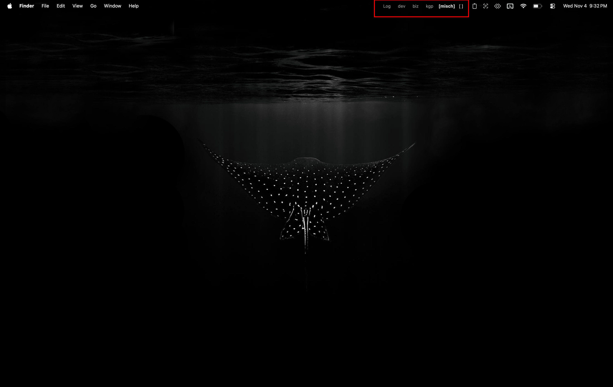

# Menu Bar Spaces

Name, see, and switch macOS Desktops from the menu bar horizontally.



## Download

[MenuBarSpaces-0.1.0.dmg](https://github.com/capitanbarbosa/MenuBarSpaces/releases/latest/download/MenuBarSpaces-0.1.0.dmg) from the latest GitHub Release.

## First launch

The DMG is signed and notarized. Open it, drag `MenuBarSpaces.app` into Applications, then open it from there.

Turn on Accessibility in **System Settings → Privacy & Security** if desktop switching does not respond to clicks.

## Run from source

```sh
make run
```

That installs `/Applications/MenuBarSpaces.app` and opens it. Local rebuilds
use a development certificate.

See `RELEASING.md` to build and notarize a new DMG.
